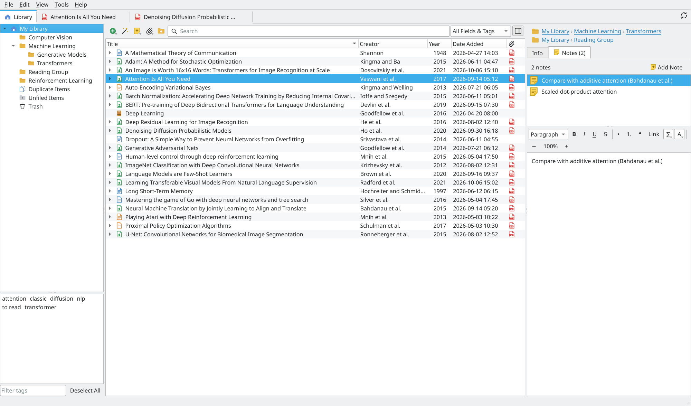
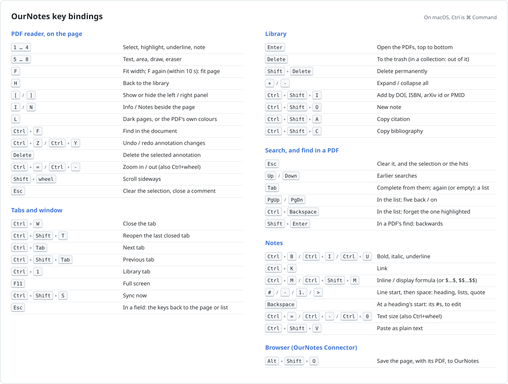

# OurNotes

OurNotes is an open-source reference manager in the spirit of Zotero: collect papers,
read and annotate PDFs, write notes, cite, and keep everything in sync — through
**your own server** (`ournotesd`) or **a plain folder** (USB drive, NAS, network share).

It is written in C++17 with Qt 6 and MuPDF, and targets Linux, macOS and Windows.

<!-- drawn by the test "docs: the README's screenshot" in tests/gui/test_gui.cpp, from a
     made-up library of well-known papers -->


## Features

- **Library** — personal and group libraries, nested collections, tags with colours,
  related items, duplicate detection and merging, trash. All 37 Zotero item types and
  their fields; data is stored in Zotero's API JSON shape. Items dragged onto another
  library or one of its collections are copied there, with their notes, attachments
  (and files) and annotations.
- **Zotero import** — copies everything from a Zotero data directory: libraries
  (including groups), collections, items, creators, tags, relations, notes (with embedded
  images), attachments and their files, annotations (highlights, underlines, notes,
  images, ink), tag colours, reading positions and CSL styles. Zotero's files are only
  read. Re-running the import picks up items changed in Zotero since.
- **PDF reader** — continuous scrolling, zoom/fit, thumbnails, outline, links, find.
  Annotation tools: highlight, underline, sticky note, text box, area (image), ink and
  eraser, eight colours, comments, move/resize. A comment shows over the page while the
  mouse rests on its annotation and is edited right there after a click, with `$…$`
  formulas as in notes. Annotations are stored like Zotero's
  (PDF user-space coordinates) and imported Zotero annotations line up exactly.
  Annotations already inside a PDF are shown read-only; *File → Export PDF with
  Annotations* writes yours into a copy of the file. Each document reopens where it was
  left (page, zoom and scroll position, kept in `storage/<KEY>/.zotero-reader-state`
  like Zotero), and the open tabs and the library's selection come back after a
  restart; restored tabs load when first shown. Beside the PDF the paper's Info (authors,
  year and the other fields, tags, related items) and its notes, the top note open;
  Info or Notes, whichever was chosen last, there and in the library alike. Shift+wheel
  scrolls sideways. On the page, keys 1–8 pick the tools (each but Select shows its icon
  as the cursor), Q, W and E your three colours (yellow, red and green to begin with; the
  gear beside the colour button changes them, for every PDF), F fits the width (twice: the
  page), H goes back to the library, `[` and `]` show or hide the left and right panels,
  I and N open Info and Notes, and L turns the pages dark or back to the PDF's own
  colours (in a light theme too); Ctrl+Shift+T reopens a closed tab. A slider in the
  toolbar sets the page colour for all PDFs: white to gray, or black to gray for dark
  pages. See [Key bindings](#key-bindings).
- **Notes** — rich-text notes (headings, lists, quotes, links, colours, pasted images)
  saved as Zotero-compatible note HTML; add selected text or annotations to a note.
  LaTeX math: type `$…$`, or `$$` to start a formula (on an empty line: a display
  formula) and type its LaTeX in place with a live preview; Ctrl+M / Ctrl+Shift+M do the
  same. Click a formula to edit it in the note; leaving it (arrow keys, Enter, Esc, the
  closing `$`) renders it again. A `$` typed after `$$…` or `$…` in the line closes the
  formula; pasting into a formula just opened makes it at once; one left empty keeps its
  `$` signs, and putting the cursor between them opens it again. Rendered with MicroTeX in the text colour (or a colour
  set in Preferences; `\textcolor{red}{…}` for single formulas) and stored like
  Zotero's math. Images are scaled to fit the note width. Selecting a paper shows its
  notes in a tab next to Info. Markdown typed or pasted becomes formatting (`# `, `- `,
  `1. `, `> `, `**bold**`, `*italic*`, `` `code` ``, `[text](url)`; Ctrl+Z gives back the
  markup). A table is typed as in Markdown: a row of cells between `|`s, a `|---|---|`
  row under it, then Enter; Tab and Enter go from cell to cell (and add rows), the
  context menu adds and deletes rows and columns, and Markdown tables pasted in are
  tables too. Backspace at the start of a heading shows its `## ` to change the level;
  leaving the line makes it a heading again. Ctrl+F in a note finds in it, in a bar at
  the bottom of the note (with the same history, Tab and Aa as the search; Esc closes it). Each note view has its own text size (− / +, Ctrl+wheel), starting at the
  size set in Preferences.
- **Adding items** — by DOI, ISBN, arXiv ID or PMID (arXiv PDFs are downloaded), by
  dropping PDFs (metadata is found from the identifiers or title in the file, with a
  progress window), or by importing BibTeX / RIS / CSL JSON. PDF text is read locally;
  only the identifier or title is sent to the public Crossref, arXiv, Open Library or
  PubMed APIs (no account or API key needed).
- **Browser extension** — the OurNotes Connector (`browser/chrome`, for Chrome and other
  Chromium browsers) saves the page you are reading to OurNotes with Alt+Shift+O or its
  button: the item from the page's citation tags (or JSON-LD, Dublin Core, Open Graph)
  and its PDF, as the browser fetched it, into the collection selected in OurNotes. See
  [docs/browser-connector.md](docs/browser-connector.md).
- **Citing** — export BibTeX, RIS, CSL JSON; bibliographies and in-text citations in
  APA, Chicago (author-date), IEEE, MLA, Harvard, Nature and Vancouver.
- **Search** — title/creator/year, all fields and tags, or everything including the
  full text of PDFs (indexed in the background with SQLite FTS5). The search field, and
  a PDF's find, keep a history as a shell does (the last 1000 searches, on this
  computer): Up and Down go through earlier searches, Tab completes from them (again, or
  in an empty field: a list, five at a time, PgUp/PgDn for more, Ctrl+Backspace to forget
  one), Esc clears the
  search and the selection (in a PDF: the word and its hits). Shift+Enter finds
  backwards; the Aa button (Alt+C) matches case. Esc in any other field gives the keys
  back to the page or the item list (there, Esc again selects nothing; I and N open Info
  and Notes, as on a PDF's page).
- **Sync** — two-way, per object, with attachment files; last writer wins and the losing
  version is kept in *Tools → Sync Conflicts*. *Tools → Sync History* lists what the last
  syncs brought in and sent out, and which of it `ournotes-cli` (an agent, a script) made
  or synced. Library names are synced, and deleting an (empty)
  library deletes it everywhere. Works with a `ournotesd` server (HTTP/HTTPS, multiple
  users, shared libraries) or with a folder.
- **Command line** — `ournotes-cli` for import/export, citing, adding items, indexing and
  syncing on headless machines.

## Building

Requirements: a C++17 compiler, CMake ≥ 3.21, Qt ≥ 6.5 (Widgets, Svg), OpenSSL ≥ 3
(for HTTPS). MuPDF is built from source automatically on Linux and macOS; SQLite is
downloaded at configure time. nlohmann/json, cpp-httplib and doctest are vendored.

### Linux

```sh
sudo apt install build-essential cmake libssl-dev libgl1-mesa-dev   # Debian/Ubuntu
# Qt 6 from your distribution (qt6-base-dev libqt6svg6-dev) or the Qt installer, e.g.
#   pip install aqtinstall && aqt install-qt linux desktop 6.8.3 linux_gcc_64 -O ~/Qt
cmake -S . -B build -DCMAKE_BUILD_TYPE=Release -DCMAKE_PREFIX_PATH=~/Qt/6.8.3/gcc_64
cmake --build build -j
ctest --test-dir build          # set OURNOTES_NO_NETWORK=1 to skip online lookups
./build/src/gui/ournotes
sudo cmake --install build      # installs ournotes, ournotes-cli, ournotesd, .desktop file
```

### Installing on Linux (per user)

```sh
scripts/install-linux.sh                # build + install, menu entry and desktop launcher
scripts/install-linux.sh --uninstall    # remove it again (your library is kept)
```

The script builds a release copy, installs it with its own Qt runtime in
`~/.local/opt/ournotes`, links `ournotes`, `ournotes-cli` and `ournotesd` into `~/.local/bin`,
and adds the icon, an application-menu entry and a launcher on the desktop. Options:
`--qt DIR`, `--prefix DIR`, `--no-desktop-shortcut`, `--no-build`.

### macOS

```sh
brew install cmake openssl@3 qt
cmake -S . -B build -DCMAKE_BUILD_TYPE=Release \
      -DOPENSSL_ROOT_DIR="$(brew --prefix openssl@3)" -DCMAKE_PREFIX_PATH="$(brew --prefix qt)"
cmake --build build -j
open build/src/gui/ournotes.app
```

`scripts/build-dmg.sh` builds a self-contained `OurNotes.app` (with Qt, OpenSSL, and
`ournotes-cli` and `ournotesd` in `OurNotes.app/Contents/MacOS`) and packs it into
`dist/OurNotes-<version>-macos-<arch>.dmg`. Options: `--qt DIR`, `--no-build`; it signs
ad hoc unless `CODESIGN_IDENTITY` (and `NOTARY_PROFILE` for notarization) is set.

### Windows (Visual Studio 2022)

```powershell
vcpkg install openssl                  # MuPDF is downloaded and built with MSBuild
cmake -S . -B build -DCMAKE_TOOLCHAIN_FILE=%VCPKG_ROOT%/scripts/buildsystems/vcpkg.cmake ^
      -DCMAKE_PREFIX_PATH=C:/Qt/6.8.3/msvc2022_64
cmake --build build --config Release
build\src\gui\Release\ournotes.exe    # with Qt's bin directory on PATH
```

Without vcpkg, OpenSSL 3 from elsewhere (the Shining Light installer, a Miniconda's
`Library` directory) works with `-DOPENSSL_ROOT_DIR=<dir>`. Its `libssl-3-x64.dll` and
`libcrypto-3-x64.dll` are copied next to the programs when they are built, and installed
with them.

Other build options: `-DMUPDF_ROOT=<prefix>` uses an existing MuPDF build;
`-DOURNOTES_BUILD_GUI=OFF -DOURNOTES_BUILD_CLI=OFF` builds only the sync server (no Qt, no
MuPDF); `-DOURNOTES_WITH_OPENSSL=OFF` builds without HTTPS.

### Packages and releases

| System | Script | Creates |
|---|---|---|
| macOS | `scripts/build-dmg.sh` | `dist/OurNotes-<version>-macos-<arch>.dmg` |
| Linux | `scripts/package-linux.sh` | `dist/OurNotes-<version>-<arch>.AppImage` and `dist/ournotes-<version>-linux-<arch>.tar.gz` |
| Windows | `scripts\package-windows.ps1` | `dist\OurNotes-<version>-windows-x64.zip` |

Each bundles the Qt runtime. Pushing a tag `v<version>` (the version in `CMakeLists.txt`;
`v<version>-rc1` and the like make a pre-release) runs `.github/workflows/release.yml`,
which builds all of them on GitHub (macOS for Apple silicon and Intel) and publishes them
as a release. Running that workflow by hand builds the packages without publishing them.
The Windows zip is also built by every CI run (`.github/workflows/ci.yml`) and kept for two
weeks under the run's *Artifacts*.

> Status: developed and tested on Linux (Ubuntu 22.04, GCC 11, Qt 6.11) and macOS 26
> (Apple silicon, Homebrew Qt 6.12). On Windows 11 (Visual Studio 2022, Qt 6.5.3) it
> builds and its tests pass; the application itself has seen little use there yet.

## Key bindings



The reader's keys (1–8, Q, W, E, F, H and the others) work while the page has the keyboard; typed into a comment,
a note or a field they are just text. `scripts/keybindings-figure.py` draws the figure.

## Getting started

On first start OurNotes offers to import an existing Zotero library (it looks for
`~/Zotero` or the data directory configured in Zotero). You can also import later with
*File → Import from Zotero…* or:

```sh
ournotes-cli import-zotero ~/Zotero
```

The interface is scaled to 150% by default; change it in *Preferences → General →
Interface scale* (100–300%, applied on restart). A `QT_SCALE_FACTOR` set in the
environment takes precedence. *Appearance* follows the system's light or dark theme by
default, or can be set to Light or Dark (applied immediately). In dark mode PDF pages
are shown dark too (light text on dark paper, colours keep their hue); switch to the
PDF's own colours with L on the page, the moon button in the reader toolbar or in
Preferences, and to dark pages in a light theme the same way.

Data lives in `~/OurNotes` (database `ournotes.sqlite`, files in `storage/<KEY>/`), like
Zotero's data directory; change it in *Preferences → General* or with
`OURNOTES_DATA_DIR`. Settings and sync tokens are in `~/.config/ournotes/config.json`
(macOS: `~/Library/Application Support/OurNotes`, Windows: `%APPDATA%\OurNotes`).

OurNotes was called freePen before. On its first start it takes over freePen's settings
(copied from `~/.config/freepen`) and moves the library from `~/freePen` to `~/OurNotes`;
a data directory chosen in the settings stays where it is. An `ournotesd` server finds the
data of a server set up as `freepend`.

## Sync

**With a server.** On any machine you control:

```sh
ournotesd useradd alice                     # prompts for a password
ournotesd serve --port 8642                 # add --cert/--key for HTTPS, or use a reverse proxy
```

Then in OurNotes: *Preferences → Sync → Add Server…*, enter the URL, user name and
password (only a sign-in token is stored). Libraries can be shared between accounts with
`ournotesd share <library-uid> bob --role write`. See [docs/server.md](docs/server.md) for
TLS, systemd and backups, and [docs/sync-protocol.md](docs/sync-protocol.md) for the API.

**With a folder.** *Preferences → Sync → Add Folder…* and pick a directory on a USB drive
or network share. Every computer that syncs with the same folder gets the same libraries.
Use it from one computer at a time (it is not meant for live sharing by Dropbox-style
tools, which can corrupt databases).

*Tools → Storage and Sync Status* shows what OurNotes takes on this computer's disk (the
database, the full-text index, each library's files) and the room left, and how the sync
target is doing: its version and sync API, its disk, and what it holds of each library.

Sync runs automatically after edits, as soon as another computer has sent its changes (a
server tells at once, from 0.1.10 on; a folder is looked at every few seconds), and every 15
minutes (configurable), or with the sync button. Attachment files are transferred during sync
or, optionally, when first opened.

## Command line

```text
ournotes-cli info | libraries | collections | items [--search TEXT]
ournotes-cli items --collection "FA26/CS8803" --json      ournotes-cli show KEY --json
ournotes-cli text KEY      ournotes-cli set KEY title="New title"      ournotes-cli tag KEY --add exam
ournotes-cli add-note KEY - < summary.md                  ournotes-cli file KEY --collection "FA26"
ournotes-cli add paper.pdf 10.1038/nature14539 arXiv:2301.08243
ournotes-cli import refs.bib            ournotes-cli export --format ris -o out.ris
ournotes-cli cite KEY... --style ieee   ournotes-cli index
ournotes-cli add-server https://host:8642 --user alice    ournotes-cli sync
```

**AI agents** (Claude Code, Codex, ...) can work on a library through `ournotes-cli`:
summarise the papers in a collection into notes, rename titles, tag and file items.
[docs/agents.md](docs/agents.md) tells them how (also `ournotes-cli guide`); point an agent
at it. Changes go out with the app's next sync, and an open app shows them within seconds;
*Tools → Sync History* tells them apart from the user's own.

## Architecture

```
src/core     Qt-free library: SQLite database (items/collections/settings as JSON with
             derived columns), FTS5 full-text index, Zotero importer, sync engine
src/sync     sync storage (also used for folder targets), HTTP and folder transports,
             HTTP API of the server
src/server   ournotesd, the sync daemon (needs only the C++ standard library + core)
src/pdf      MuPDF wrapper: rendering, text geometry, search, outline, annotations
src/formats  BibTeX/RIS/CSL JSON, DOI/arXiv/ISBN/PMID lookup, citation styles
src/cli      ournotes-cli
src/gui      Qt 6 desktop application
tests/       doctest suites for every module (GUI tests use Qt Test, offscreen)
resources/   item type schema, application icon (SVG source + generated PNG/ICO/ICNS)
tools/       gen_schema.py (schema from a Zotero database), render_icons (icon assets)
scripts/     install-linux.sh
```

Every object (item, collection, setting) carries the server version it was last synced
at and a local revision counter; deletions leave tombstones. A sync pulls changes since the
last known library version, reconciles them with local edits, transfers files by MD5, and
pushes local changes with optimistic concurrency.

## Known limitations

- Citation styles are built in; the CSL files copied from Zotero are kept in
  `~/OurNotes/styles` but not yet interpreted.
- EPUB and HTML snapshots open in the system viewer; annotations are PDF-only.
- Zotero feeds, saved searches and its web sync are not imported/supported.
- Notes are rewritten as clean HTML when you edit them; Zotero-specific markup
  (embedded citation data) in edited notes is reduced to its visible text.

## License

OurNotes is free software under the GNU Affero General Public License v3 (see `LICENSE`),
the same license as Zotero and MuPDF. The item type schema is derived from Zotero.
Third-party code: MuPDF (AGPL-3.0), Qt (LGPL-3.0), SQLite (public domain),
nlohmann/json, cpp-httplib, doctest and MicroTeX (MIT), tinyxml2 (zlib).
